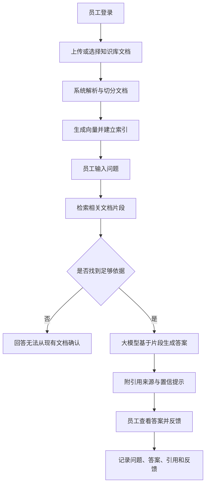

# 文档智能问答 AI 助手

一个面向企业内部知识库的 RAG（Retrieval-Augmented Generation，检索增强生成）问答产品示例。员工上传制度、流程、产品手册等文档后，AI 只基于已授权的文档内容回答问题，并给出引用来源，以降低幻觉风险。

## 产品目标

- 让员工用自然语言快速找到内部知识。
- 让每个答案尽量可追溯、可验证。
- 当文档中没有答案时，明确说明“无法从现有文档中找到依据”，而不是编造内容。
- 为企业后续接入权限、审计、运营分析预留产品能力。

## 目标用户

| 用户角色 | 典型需求 |
| --- | --- |
| 普通员工 | 查询请假、报销、办公流程、产品资料等内部信息 |
| 新员工 | 快速了解公司制度、团队规范和入职流程 |
| 客服/售前 | 基于最新产品手册和 FAQ 准确回复客户 |
| 知识库管理员 | 上传、更新、下架文档，维护知识质量 |
| 安全/合规人员 | 控制文档权限，查看问答审计记录 |

## 产品流程图

## 功能介绍

### 1. 文档上传与解析

支持上传 PDF、Word、Markdown、TXT 等常见文档。系统提取正文、标题、页码和章节信息，为后续检索和引用保留来源。

### 2. 知识库检索

将用户问题转换为检索请求，从已授权文档中找出最相关的片段。可通过关键词检索、向量检索或混合检索提高召回率。

### 3. 基于文档回答

模型仅根据检索到的文档片段生成答案。答案应包含清晰结论、必要解释和引用来源；证据不足时必须拒答。

### 4. 引用与可追溯

回答下方展示文档名、章节、页码和原文片段，方便员工核查。引用不可伪造，找不到引用时不得生成引用。

### 5. 权限与数据隔离

用户只能检索和引用自己有权限访问的文档。不同部门、项目和租户之间保持数据隔离。

### 6. 反馈与运营

员工可标记“有帮助”“无帮助”“引用不准确”或补充意见。运营人员据此分析高频问题、低质量文档和检索失败原因。

## 演示案例

**用户问题**

> 出差住宿费的标准是多少？需要提前审批吗？

**知识库依据**

- 《差旅管理制度》第 3 章“住宿标准”
- 《费用报销流程》第 2 节“出差审批”

**AI 回答**

> 根据《差旅管理制度》第 3 章，普通员工一线城市住宿标准为每晚不超过 500 元，其他城市不超过 350 元。出差前需要在《费用报销流程》第 2 节规定的审批系统中提交出差申请，并取得直属负责人批准。特殊情况需要按制度申请例外审批。
>
> 引用：
> 1. 《差旅管理制度》第 3 章“住宿标准”
> 2. 《费用报销流程》第 2 节“出差审批”

**超出文档范围示例**

**用户问题**

> 明年差旅标准会不会上涨？

**AI 回答**

> 现有文档中没有关于明年差旅标准调整的信息，因此无法确认。建议咨询财务或行政管理部门。

## 文档索引

- [PRD.md](PRD.md)：产品需求、用户角色、功能清单、流程、风险和指标
- [evaluation.md](evaluation.md)：测试集、评估指标和判定标准
- [prompt-library.md](prompt-library.md)：减少幻觉的系统提示词与回答模板
- [cases.md](cases.md)：正常、越界、模糊和风险场景测试用例

## 本地预览

Markdown 文件可直接使用支持 Mermaid 的编辑器打开，例如 VS Code、Typora 或 GitHub 网页预览。

## 后续可执行方向

1. 选择大模型 API 和向量数据库，实现最小可用原型。
2. 导入少量真实或脱敏文档，跑通上传、检索、回答、引用链路。
3. 使用 `cases.md` 建立回归测试集，按 `evaluation.md` 持续评测。
4. 加入文档权限、审计日志和人工反馈闭环。
